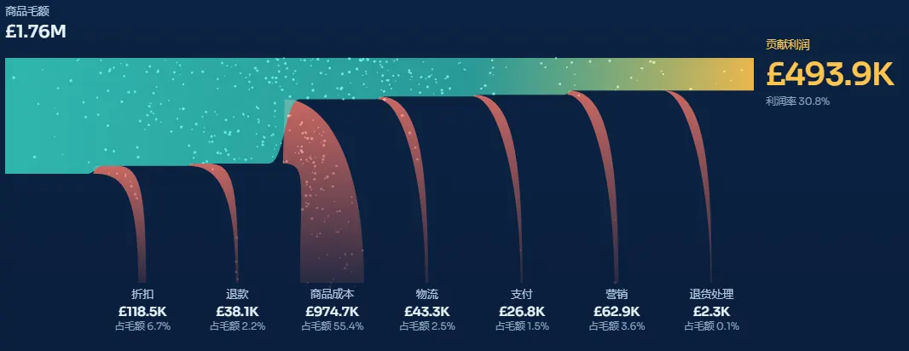
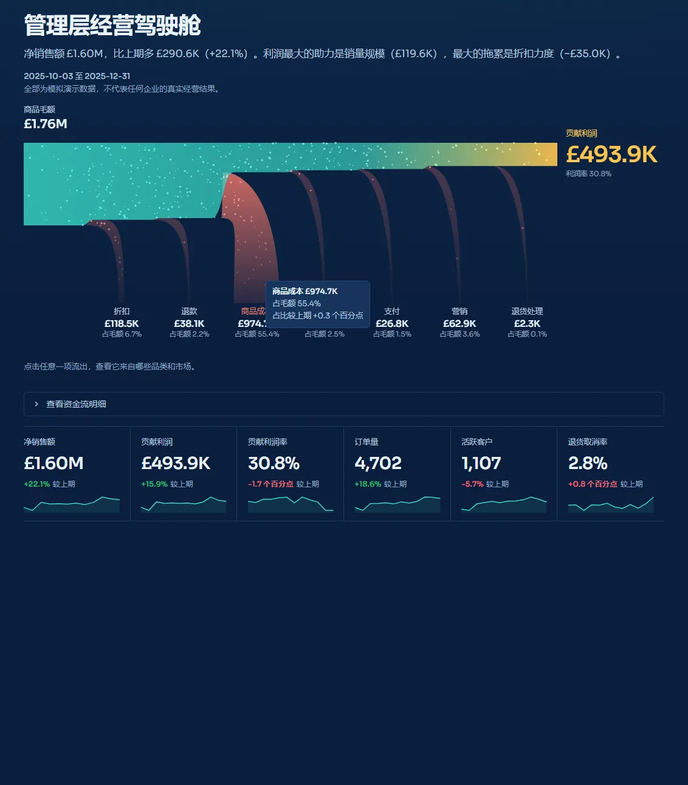
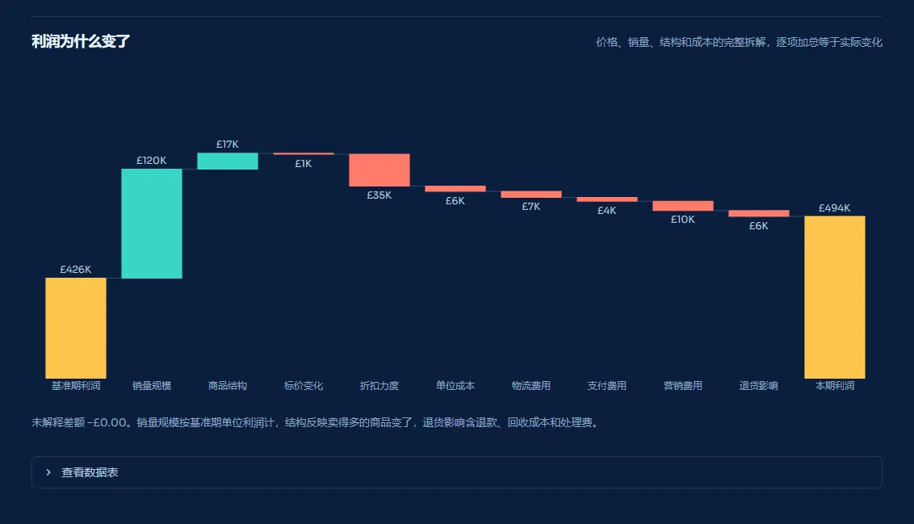
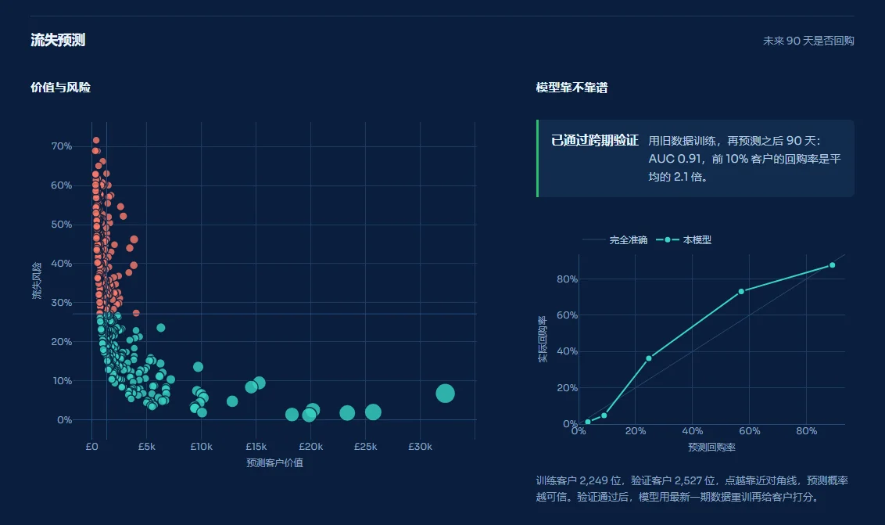
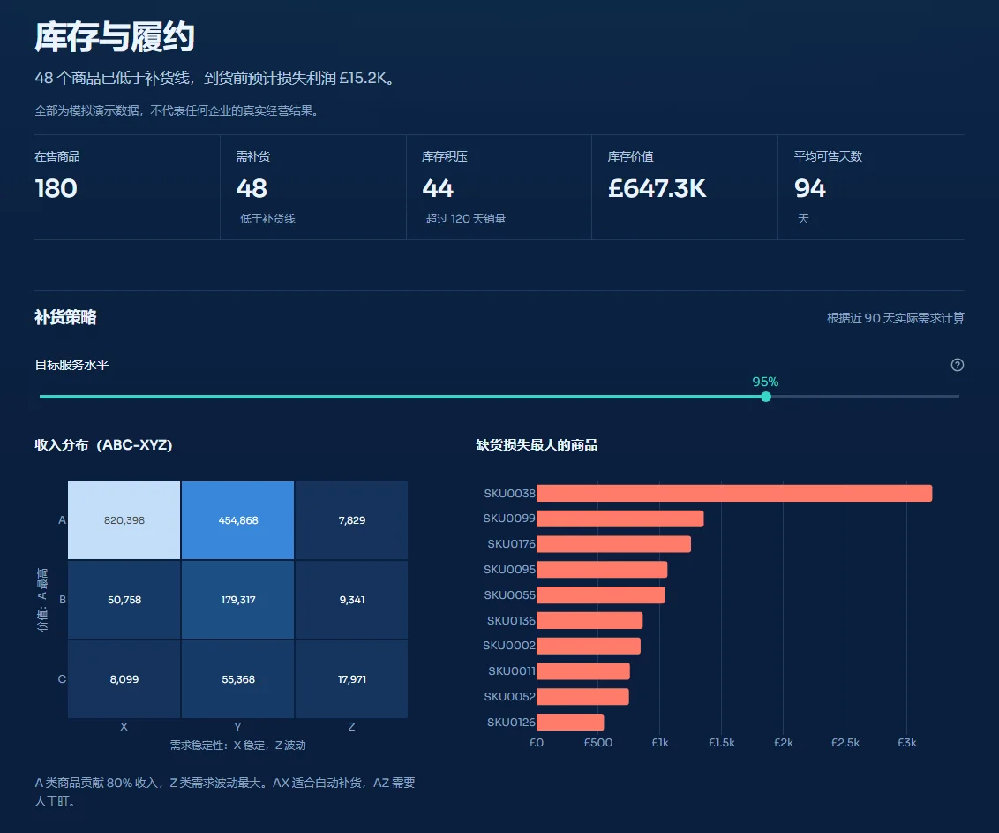
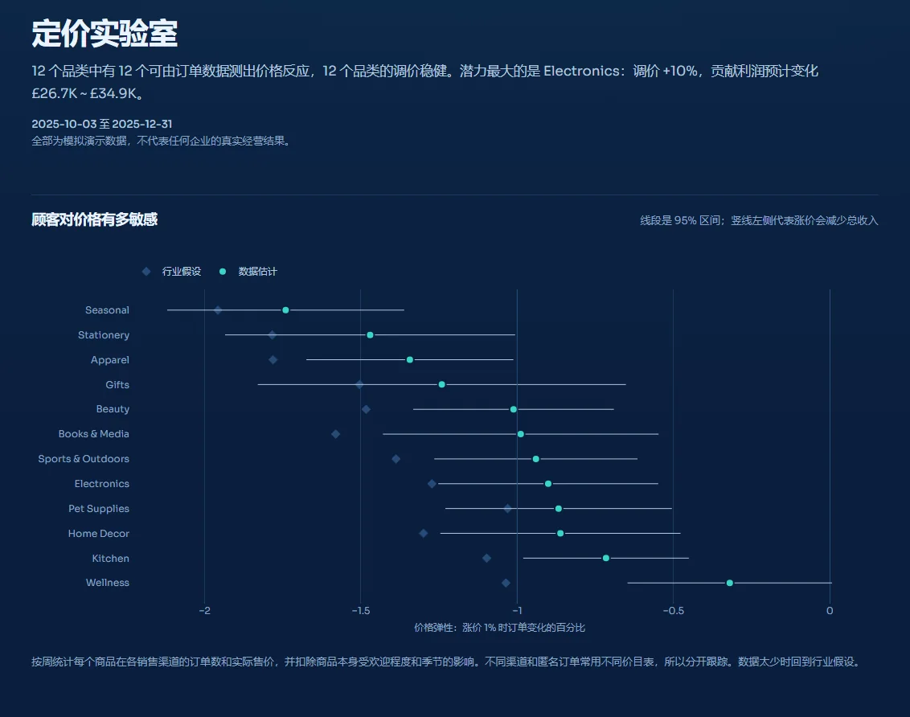
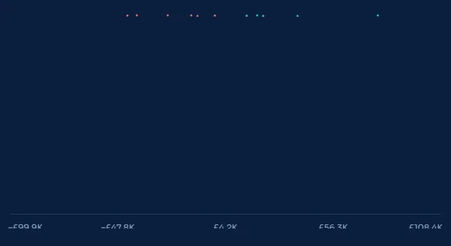
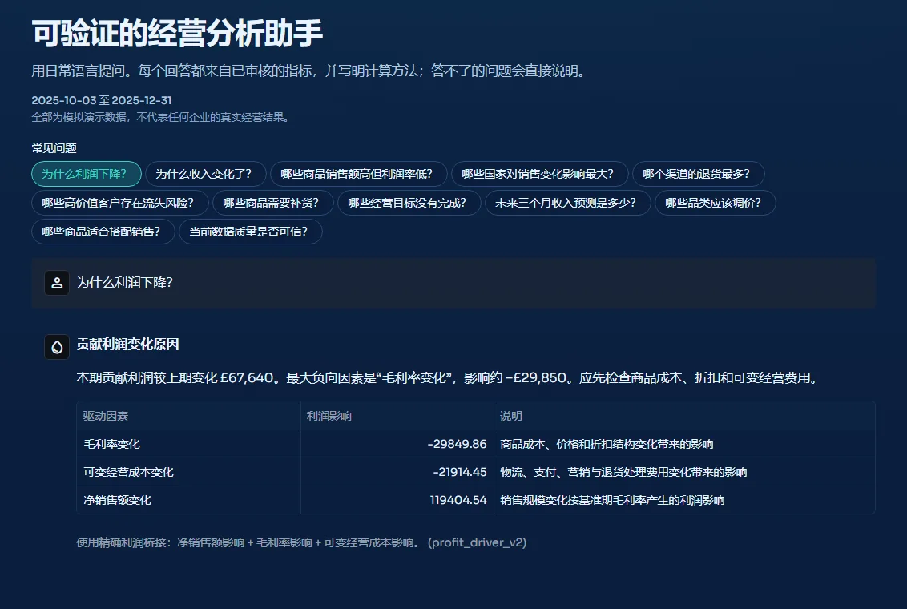
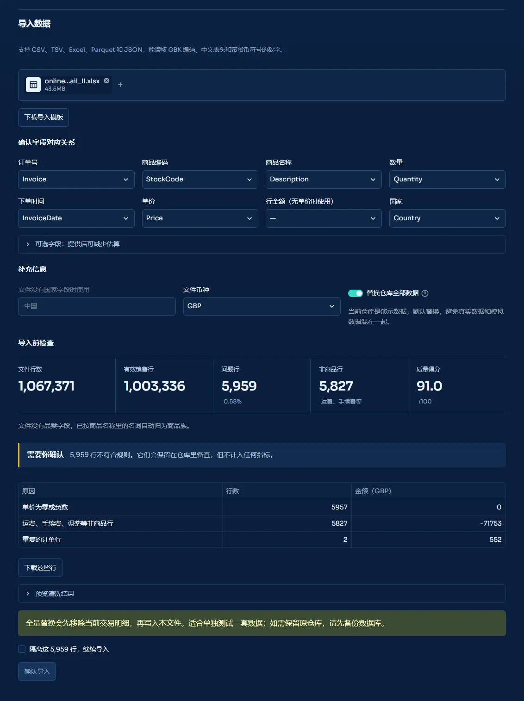
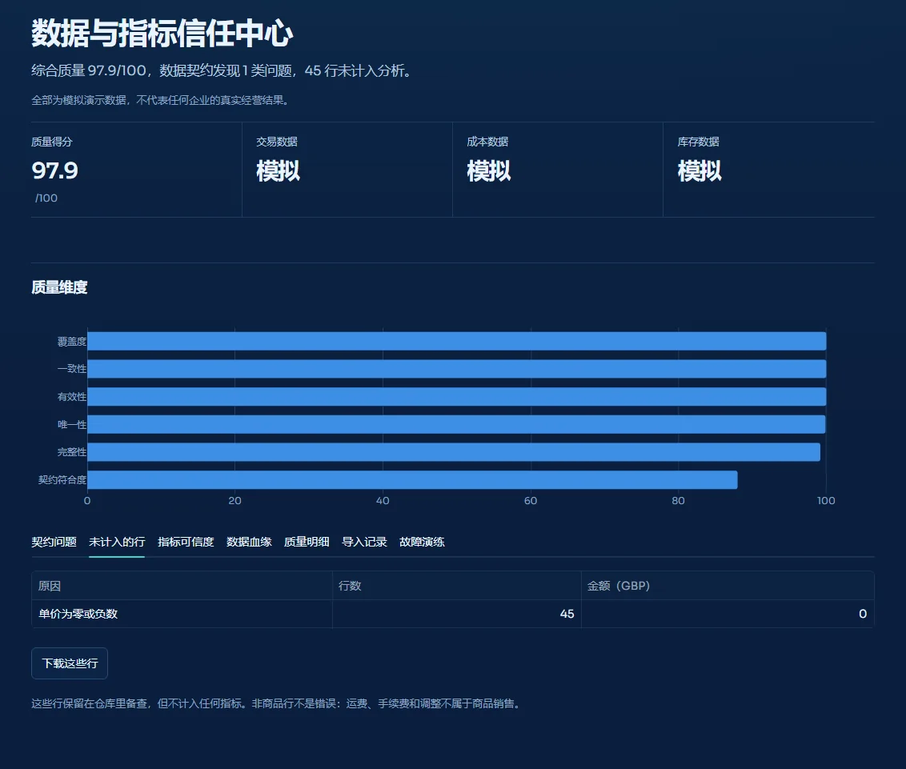

# InsightFlow

English | [中文](README.md)

InsightFlow is a retail analytics and decision platform. It turns transaction data into a money flow you can see, shows where revenue comes from and where it leaks away, and simulates the result of a decision before you make it.

Version 2.0.0 has been tested on a real public ledger of 1.06 million lines, covering import, reconciliation and every page; see "Validation on real data" below. The [showcase page](https://zhao-yushen.github.io/InsightFlow-Analytics/en/) walks through each feature with screenshots and animations.



The money river: the width of the channel is the amount, each stream that branches off downward is an outflow, and what reaches the right edge is contribution profit. Screenshots and animations use reproducible simulated data and do not represent any real company's results. The "Importing real data" section uses the public UCI Online Retail II dataset. The screenshots show the Chinese interface; the app also has an English one, which you can pick under "语言 / Language" in the sidebar.

## What it answers

| You want to know | Where to look | How it works |
|---|---|---|
| Where the money went, and why it changed this month | Executive Overview, Profitability & Unit Economics | A live money flow (click any outflow to drill into categories and markets) and a price, volume, mix and cost bridge whose items add up to the actual change |
| Which markets make money | Global Markets | A globe you can drag; click a market for its details |
| How sensitive customers are to price, and whether to change it | Pricing Lab | Price elasticity estimated from order data, with the profit impact of each price move |
| Whether a plan is worth doing | Probabilistic Decision Lab | Monte Carlo simulation, plus an automatic search over 245 combinations of price, discount and marketing |
| Which customers may not buy again | Customer Value & Churn | A churn model that is switched on only after out-of-time validation |
| Which products to restock, and how many | Inventory & Fulfillment | ABC-XYZ classes and safety stock set by service level; without stock data, demand analysis only |
| Whether an A/B test supports a conclusion | A/B Experiment Analysis | Bootstrap intervals, a check that the groups were split evenly, and sample size estimates |
| Whether the numbers can be trusted | Trust Center | Each line records its source, and a metric is only as trustworthy as its weakest input |

## Feature tour

### Where the money went: Executive Overview

The page opens with one sentence on what happened this period. Below it, the money river draws the income statement as a flow. Click any outflow to open its breakdown by category and by market, along with how its share of sales has moved against the comparison period. You can compare with the previous period or with the same period last year.



### Why profit changed

The change in profit is split into volume, product mix, list price, discounting, unit cost, new and discontinued products, shipping, payment fees, marketing and returns. The parts add up to the actual change, and the unexplained remainder is shown on its own; on the demo data it is £0.00.



### Which markets make money

The globe turns when you drag it. Bubble size is net revenue; teal marks a margin above the overall margin, and coral one below it. Click a market, or select it with the keyboard, to see its size, margin, return rate and main categories. The app recognises 132 countries and regions, including spellings such as EIRE and RSA.


### Who may stop buying

The churn model is trained on older data and scored on what customers actually did in the following 90 days. If its AUC is below 0.60, it is not used. A calibration chart shows whether predicted probabilities match actual repurchase rates, and the priority contact list is sorted by expected profit × churn risk.



### What sells and what to restock

Products fall into nine ABC-XYZ classes by value and demand stability. Safety stock depends on the service level, demand variability and lead-time variability together. Demand is counted net of returns. When the data has no stock levels, the page analyses demand only and does not invent stock.



### Whether to change a price

Price elasticity is estimated from order data. Each sales channel is tracked on its own, product popularity and seasonality are held fixed, and standard errors are clustered by product. Every price recommendation shows the profit change at both ends of the 95% elasticity interval, and it counts as robust only if the unfavourable end still makes money.



### Simulate first, then decide

After you change price, discount, marketing or cost, the lab draws 5,000 possible futures and reports the distribution of the profit change, the probability of an improvement and the assumptions the result is most sensitive to. The optimiser runs every plan against the same simulated futures and marks the plans with the best return for their level of risk.



### Questions, diagnostics and actions

Ask in plain language, for example "Why did profit fall?". The assistant answers only questions that its reviewed queries cover, and it shows how each answer was calculated. Issues found by the diagnostics can become actions with an owner, a due date and a status.



### Importing real data

This is the import of the 1.06-million-line UCI Online Retail II workbook. Columns are matched automatically, and before anything is imported the page lists 5,959 problem lines and 5,827 postage and fee lines with their reasons and amounts. The import button stays disabled until you tick the box that sets those lines aside.



### Every number has a source

Each line records a separate source status for the transaction, discount, cost and stock, and a metric's trust level depends on its weakest input. Lines left out of the analysis are listed by reason and can be downloaded for checking.



The [showcase page](https://zhao-yushen.github.io/InsightFlow-Analytics/en/) covers more pages in more detail.

## Quick start

On Windows, double-click `run_windows.bat`, or run:

```bash
python -m venv .venv
.venv\Scripts\activate
pip install -e .
insightflow run
```

The first launch generates demo data, which takes about 15 seconds. The default address is `http://127.0.0.1:8501`.

Docker works too:

```bash
docker compose up --build
```

InsightFlow needs Python 3.10 or later.

## Using your own data

Open "Data Hub & Live Refresh", upload a file and confirm how its columns map.

- It reads CSV, TSV, Excel, Parquet and JSON files.
- It recognises GBK encoding, Chinese headers, numbers written as `￥1,299.00` or `1.299,50`, and dates written as `2025年3月1日` or as Excel serial numbers.
- A missing unit price is derived from the line amount, and a missing product code is replaced by the product name. Every derived value is flagged.
- A cancelled or refunded order is recorded as a sale plus an offsetting entry.
- Raw values are checked before anything is estimated. A few bad lines do not sink the whole file: they are set aside and kept out of every metric, and before the import the page lists their reasons, asks you to confirm and lets you download them. An import is refused only for a structural problem, such as a missing exchange rate, or when more than 30% of lines fail, which usually means a column was mapped wrongly.
- Postage, marketplace fees, bank charges, manual adjustments and gift cards do not count as merchandise sales. They are listed separately with their amounts.
- Nothing is made up. Without a discount column, the paid price is taken as it is, and net revenue reconciles with the source file to the penny. Missing stock or supplier data stays empty, and the inventory page then analyses demand only. Without categories, products are grouped into families by name.
- The warehouse is backed up before every import. The latest 3 backups are kept, and you can restore one from the page. While the warehouse still holds demo data, an import replaces it by default, so real and simulated data do not mix.
- The warehouse uses a single reporting currency. Importing another currency requires an exchange rate, and amounts in different currencies are never added together.

You can also drop files into `data/incoming` and let the command line import them:

```bash
insightflow watch --interval 30
```

Two public datasets have their own adapters:

```bash
python scripts/import_uci.py --input "D:\data\online_retail_II.xlsx"
```

```bash
python scripts/import_olist.py --directory "D:\data\olist" --db data\warehouse\olist.db
```

## Metric definitions

```text
Net revenue         = gross sales − discounts − refunds
Gross profit        = net revenue − product cost (cost of returned goods is reversed)
Contribution profit = gross profit − shipping − payment − marketing − return handling
```

A return is a reversing entry, so totals at every level already net out returns. The [metric dictionary](docs/metric_dictionary.md) has the full definitions.

## Methods

The [methodology](docs/methodology.md) describes each model's approach, assumptions and limits. The main choices:

- Price elasticity comes from a Poisson fixed-effects regression on weekly order counts. Each product is followed separately in each sales channel, because channels often use different price lists. Standard errors are clustered by product, and estimates are shrunk toward a category prior. Every price recommendation shows the profit at both ends of the elasticity interval.
- The churn model is trained on older data and scored on the 90 days that follow. When it does not meet the bar, the page says so and uses a rule-based score.
- An A/B result whose interval crosses zero is reported as inconclusive, so noise is not presented as a finding.
- Forecasts come from several time-series models compared in a rolling backtest, and the best one is used. An unfinished month is left out of training and drawn as a dashed line on the trend chart.
- Comparisons can use the previous period or the same period last year, and changes, bridges, diagnostics and the assistant all follow that choice. Filters are written into the URL, so copying the link shares the same view.
- The assistant matches questions to reviewed query templates by keyword. When a question is out of scope, it says that it cannot answer.

With `OPENAI_API_KEY` set, a large language model writes the management summary in reports. Without it, a rule engine writes the summary. No other feature depends on a language model.

## Engineering quality

```bash
pip install -e ".[dev]"
python -m pytest --cov=src/insightflow --cov-report=term-missing --cov-fail-under=80 -q
python -m ruff check src tests scripts streamlit_app.py
python -m bandit -q -r src -x src/insightflow/pages -lll -ii
```

The latest results are in the [validation record](docs/validation.md). Every page has an automated rendering test, and the coverage figure includes the interface code. CI runs on Python 3.11 and 3.13.

## Validation on real data

The whole process was tested on the public UCI Online Retail II dataset (1.06 million lines across two yearly sheets), with the upload and import done in a real browser:

- Net revenue plus the value of the set-aside lines reconciles with the deduplicated source file to the penny, with a difference of £0.00.
- 5,959 problem lines (0.58%) were set aside and 5,827 postage and fee lines were listed separately, and the file imported normally.
- All 17 pages open on the imported warehouse, and repeat visits take under 0.6 seconds.
- The revenue forecast has a rolling-backtest WAPE of 6.5%, and the churn model has an out-of-time AUC of 0.79.

The run exposed more than ten problems that only show up in real data. All of them are fixed; the validation record lists them.

## Configuration

Copy `.env.example` to `.env` and edit it.

| Variable | Purpose | Default |
|---|---|---|
| `INSIGHTFLOW_CURRENCY` | Reporting currency for a new warehouse | `GBP` |
| `INSIGHTFLOW_RETURN_RECOVERY_RATE` | Share of returned goods that can be sold again | `1.0` |
| `INSIGHTFLOW_READ_ONLY` | Read-only mode for public demos | `false` |
| `INSIGHTFLOW_ACCESS_CODE` | When set, visitors need this code to get in; suits a small team sharing one instance | empty |
| `INSIGHTFLOW_STRICT_IMPORT` | For imports from the watched folder, refuse the whole file if any line fails | `false` |
| `OPENAI_API_KEY` | Turns on language-model summaries | empty |

## Limits

- The built-in transactions, costs, stock, targets and experiments are simulated.
- Without cost data, profit is estimated by rule and is not an audited figure. Without stock data, the app makes no restocking call.
- Default business targets are the average of the last three months plus a rule-based uplift. They are not an approved budget.
- The price model is reliable only near historical prices. Run an experiment before changing prices across the board.
- The access code is a single shared gate, not a user account system. A company deployment also needs authentication, permissions, monitoring, off-site backups and privacy governance.

## Documentation

- [Architecture](docs/architecture.md)
- [Methodology](docs/methodology.md)
- [Metric dictionary](docs/metric_dictionary.md)
- [Data sources and trust](docs/data_profiles.md)
- [Power BI guide](docs/powerbi_guide.md) (in Chinese)
- [Case study: profit decline](docs/case_studies/profit_decline_case.md)
- [Release notes](docs/release-notes/)

## License

MIT

## Author

Designed and built by Zhao Yushen.

AI coding tools helped with parts of the code, tests, debugging and documentation. The author did the core product design, the business framework, the choice of features and the acceptance testing.
