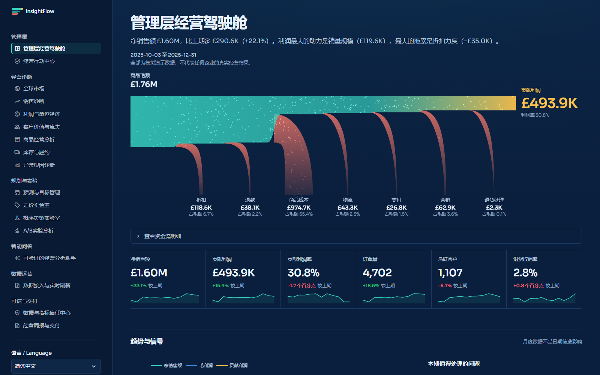
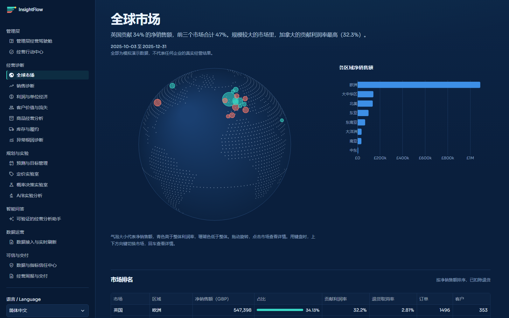
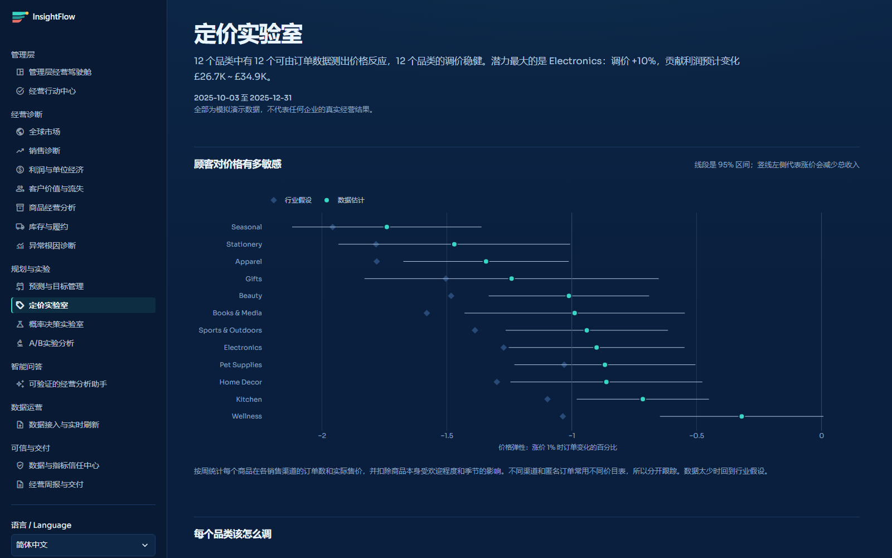
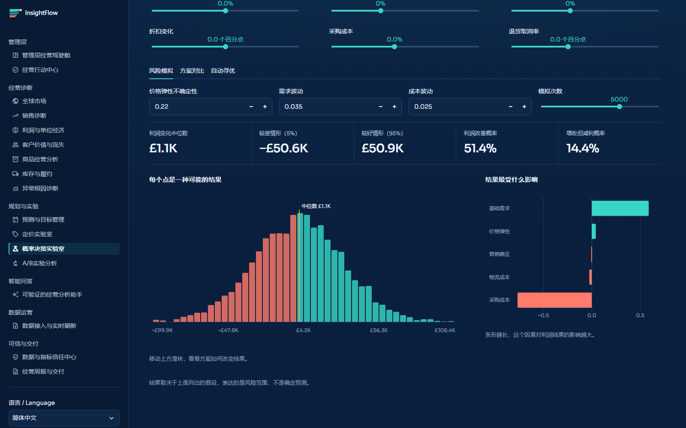

# InsightFlow

InsightFlow 是一个经营分析与决策平台：把零售交易数据变成一条看得见的资金流，告诉你钱从哪里来、在哪里流失，并在你做决定之前先模拟结果。

当前版本 2.0.0，已在 106 万行的真实公开账本上完整验证，见下文“真实数据验证”。



| 全球市场 | 定价实验室 | 概率决策实验室 |
|---|---|---|
|  |  |  |

所有截图均为可复现的模拟数据，不代表任何企业的真实经营结果。

## 它能回答什么

| 你想知道 | 去哪里看 | 用什么方法 |
|---|---|---|
| 钱去了哪里，这个月为什么变了 | 经营总览、利润与单位经济 | 动态资金流（点击任一项流出可钻取到品类和市场）、价格-销量-结构-成本桥接，逐项加总等于实际变化 |
| 哪个市场在赚钱 | 全球市场 | 可拖动的地球仪，点击市场查看详情 |
| 顾客对价格有多敏感，该不该调价 | 定价实验室 | 用订单数据估计价格弹性，并估算每次调价的利润影响 |
| 这个方案值不值得做 | 概率决策实验室 | Monte Carlo 模拟，并自动搜索 245 个价格、折扣和营销组合 |
| 哪些客户可能不再回购 | 客户价值与流失 | 流失预测模型，经过跨期验证才启用 |
| 哪些商品该补货，补多少 | 库存与履约 | ABC-XYZ 分类、按服务水平计算安全库存；没有库存数据时只分析需求 |
| 这次 A/B 测试能下结论吗 | A/B 实验分析 | Bootstrap 区间、分组检查、样本量估算 |
| 这些数字可信吗 | 数据与指标信任中心 | 逐行记录来源，指标可信度由最弱的输入决定 |

## 快速开始

Windows 上双击 `run_windows.bat`，或者手动运行：

```bash
python -m venv .venv
.venv\Scripts\activate
pip install -e .
insightflow run
```

首次打开会自动生成演示数据，约需 15 秒。默认地址是 `http://127.0.0.1:8501`。

也可以用 Docker：

```bash
docker compose up --build
```

需要 Python 3.10 或更高版本。

## 接入你自己的数据

打开“数据接入与实时刷新”，上传文件后确认字段对应关系即可。

- **文件格式：** CSV、TSV、Excel、Parquet、JSON。
- **自动识别：** GBK 编码、中文表头、`￥1,299.00` 或 `1.299,50` 这样的数字、`2025年3月1日` 和 Excel 序列号日期。
- **缺失字段：** 没有单价时由行金额推算，没有商品编码时用商品名称，每一处推算都会提示。
- **订单状态：** 已取消或已退款的订单会记为一笔销售加一笔对冲。
- **导入把关：** 在做任何估算之前先校验原始值。少量问题行不会拖垮整个文件：它们被隔离、不计入任何指标，导入前会列出原因并让你确认，也可以下载核对。只有缺少汇率这类结构性问题，或超过 30% 的行不合格（多半是字段映射错了），才会拒绝导入。
- **非商品行：** 运费、平台手续费、银行费用、手工调整和礼品卡不算商品销售，单独列出金额。
- **不编造数据：** 没有折扣字段时按成交价计，净销售额与源文件逐分对账；没有库存或供应商时留空，库存页只做需求分析；没有品类时按商品名称归并成商品族。
- **备份：** 每次导入前自动备份仓库，保留最近 3 份，可在页面上恢复。仓库还是演示数据时，导入默认替换，避免真实数据和模拟数据混在一起。
- **币种：** 仓库只用一种报告币种，导入其他币种时需要填写汇率，不会把不同货币直接相加。

也可以把文件放进 `data/incoming`，由命令行自动导入：

```bash
insightflow watch --interval 30
```

公开数据集有专用适配器：

```bash
python scripts/import_uci.py --input "D:\data\online_retail_II.xlsx"
```

```bash
python scripts/import_olist.py --directory "D:\data\olist" --db data\warehouse\olist.db
```

## 指标口径

```text
净销售额 = 商品毛额 − 折扣 − 退款
毛利润   = 净销售额 − 商品成本（退回商品的成本已冲回）
贡献利润 = 毛利润 − 物流 − 支付 − 营销 − 退货处理
```

退货是一条反向记录，所以任何维度的汇总都已经扣除退货。详细定义见[指标字典](docs/metric_dictionary.md)。

## 分析方法

每个模型的做法、假设和局限都写在[方法说明](docs/methodology.md)里。几个关键取舍：

- **价格弹性：** 用周度订单数做泊松固定效应回归，按商品在每个销售渠道分别跟踪（不同渠道常用不同价目表），误差按商品聚类，再向品类先验收缩。每条调价建议都给出弹性区间两端的利润。
- **流失预测：** 用旧数据训练，用之后 90 天打分。模型达不到标准时，页面会明确说明并改用规则分数。
- **A/B 实验：** 区间跨过 0 时判定为证据不足，不会把噪声说成结论。
- **预测：** 多个时序模型滚动回测后选优，未结束的月份不参与训练，在趋势图上以虚线标出。
- **对比基准：** 可以选上一周期或去年同期，变化、桥接、诊断和问答都按所选基准计算。筛选条件会写进网址，复制链接即可分享同一视图。
- **问答助手：** 按关键词匹配已审核的查询模板。超出范围的问题会直接说明答不了。

配置 `OPENAI_API_KEY` 后，报告里的管理层摘要会由大模型撰写；不配置时使用规则引擎，其他功能都不依赖大模型。

## 工程质量

```bash
pip install -e ".[dev]"
python -m pytest --cov=src/insightflow --cov-report=term-missing --cov-fail-under=80 -q
python -m ruff check src tests scripts streamlit_app.py
python -m bandit -q -r src -x src/insightflow/pages -lll -ii
```

最新结果见[验证记录](docs/validation.md)。每个页面都有自动化渲染测试，覆盖率统计包含界面代码。CI 在 Python 3.11 和 3.13 上运行。

## 真实数据验证

用公开的 UCI Online Retail II（106 万行，两个年度工作表）完整跑过一遍，并在真实浏览器里上传导入：

- 净销售额加上被隔离行的金额，与去重后的源文件逐分对账，差额 £0.00。
- 5,959 行问题行（0.58%）被隔离，5,827 行运费和手续费单独列出，文件正常导入。
- 17 个页面在导入后的仓库上全部正常打开，重复访问都在 0.6 秒以内。
- 收入预测滚动回测 WAPE 6.5%，流失模型跨期 AUC 0.79。

这次实测暴露并修复了十几个只有真实数据才会出现的问题，详见验证记录。

## 配置

复制 `.env.example` 为 `.env` 后修改。

| 变量 | 作用 | 默认值 |
|---|---|---|
| `INSIGHTFLOW_CURRENCY` | 新仓库的报告币种 | `GBP` |
| `INSIGHTFLOW_RETURN_RECOVERY_RATE` | 退回商品能重新销售的比例 | `1.0` |
| `INSIGHTFLOW_READ_ONLY` | 只读模式，用于公开演示 | `false` |
| `INSIGHTFLOW_ACCESS_CODE` | 设置后需要输入访问码才能进入，适合小团队共用 | 空 |
| `INSIGHTFLOW_STRICT_IMPORT` | 监听目录导入时，只要有一行不合格就拒绝整个文件 | `false` |
| `OPENAI_API_KEY` | 启用大模型摘要 | 空 |

## 边界说明

- 内置的交易、成本、库存、目标和实验都是模拟数据。
- 没有提供成本时，利润按规则估算，不是审计数字；没有库存时不给补货结论。
- 经营目标默认由近三个月均值加规则增幅生成，并非已批准预算。
- 价格模型只在历史价格附近可靠，全量调价前请先做实验。
- 访问码只是一道共用的门，不是账号体系。企业部署还需要身份认证、权限、监控、异地备份和隐私治理。

## 文档

- [架构说明](docs/architecture.md)
- [方法说明](docs/methodology.md)
- [指标字典](docs/metric_dictionary.md)
- [数据来源与可信度](docs/data_profiles.md)
- [Power BI 接入](docs/powerbi_guide.md)
- [利润下降案例](docs/case_studies/profit_decline_case.md)
- [版本记录](docs/release-notes/)

## License

MIT

## 作者

独立设计与开发：Zhao Yushen

本项目使用 AI 编程工具辅助完成部分代码编写、测试、调试和文档整理，核心产品设计、业务框架、功能选择与验收由作者完成。
